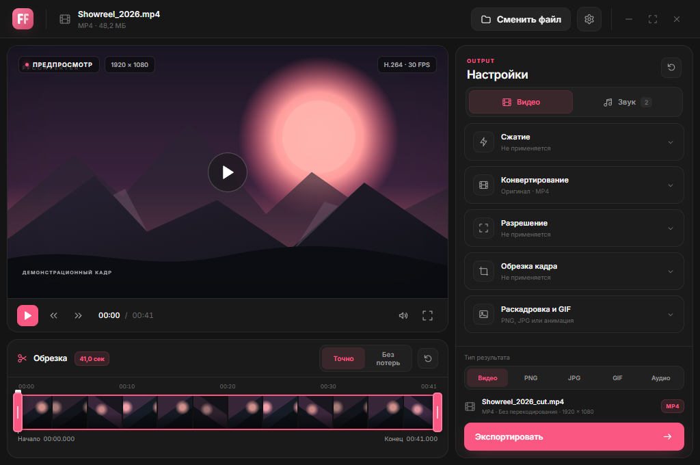

<div align="center">
  <h1>FFConverter</h1>
  <p>Локальный видеоконвертер для Windows на базе FFmpeg.</p>
  <p>
    <a href="https://github.com/TheWhitely/FFConverter/releases/latest"><strong>Скачать последнюю версию</strong></a>
  </p>
</div>



## Возможности

- Предпросмотр видео и перемотка по таймлайну.
- Обрезка фрагмента с перекодированием или без него.
- H.264, HEVC и AV1; кодирование на CPU, NVIDIA NVENC и Intel Quick Sync.
- Контейнеры MP4, MKV, MOV и WebM, включая сохранение исходного формата.
- Изменение разрешения и кадрирование.
- Отдельная громкость и отключение каждой аудиодорожки.
- Извлечение фрагмента звука в MP3, M4A, FLAC, WAV или OGG со смешиванием выбранных дорожек.
- Экспорт текущего кадра, последовательности PNG/JPG и GIF.
- Портативная работа без установки.

## Запуск

1. Откройте [последний релиз](https://github.com/TheWhitely/FFConverter/releases/latest).
2. Скачайте `FFConverter-portable.zip` и распакуйте архив.
3. Запустите `FFConverter.exe` из папки `FFConverter`.

FFmpeg и FFprobe уже включены в архив. Настройки и кэш хранятся в папке `data` рядом с программой. Открытие видео через контекстное меню Windows включается в настройках.

Приложение сообщает о новой версии после проверки обновлений. Скачивание, замена файлов и перезапуск выполняются только после подтверждения. Пользовательские настройки при обновлении сохраняются.

## Сборка

Требуются Windows, Rust, Microsoft C++ Build Tools и Tauri CLI 2. Для сборки также нужны Windows-сборки `ffmpeg.exe` и `ffprobe.exe`, например из [BtbN FFmpeg Builds](https://github.com/BtbN/FFmpeg-Builds/releases).

```powershell
git clone https://github.com/TheWhitely/FFConverter.git
cd FFConverter
cargo install tauri-cli --version 2
```

Поместите `ffmpeg.exe` и `ffprobe.exe` в `runtime`, затем выполните:

```powershell
cargo check --manifest-path src-tauri/Cargo.toml
cargo tauri build --no-bundle
cargo build --release --manifest-path src-tauri/Cargo.toml --bin updater
```

Основной исполняемый файл появится в `src-tauri/target/release/ffconverter.exe`, помощник обновления — в `src-tauri/target/release/updater.exe`.

